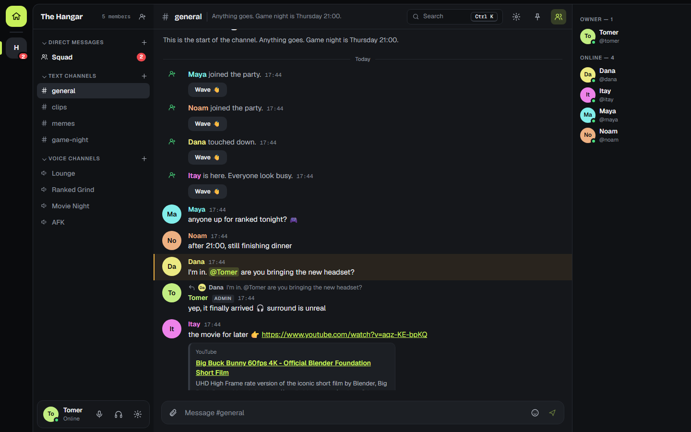
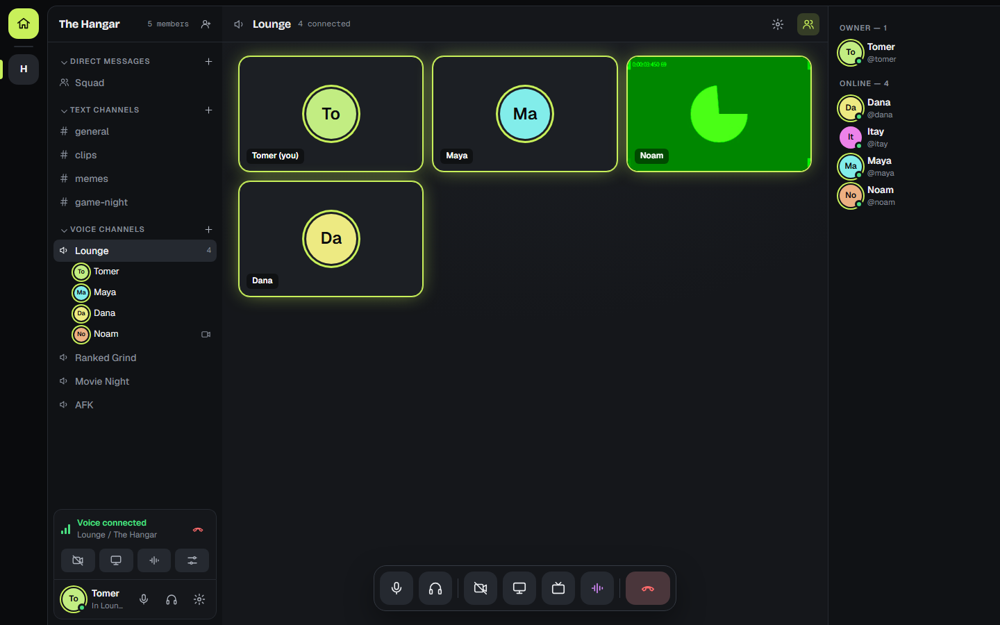
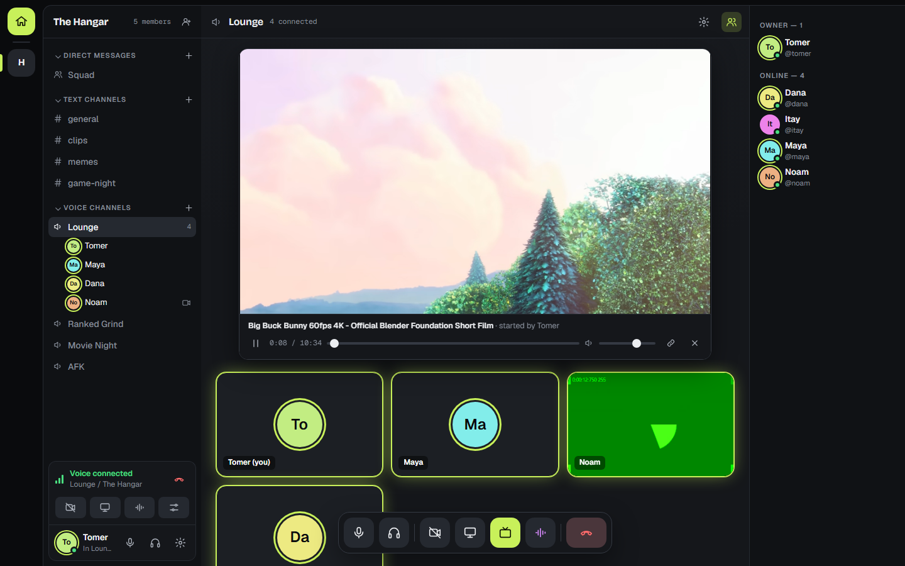
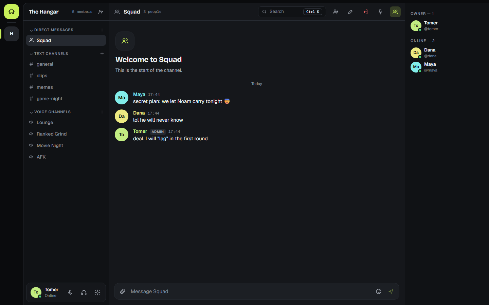
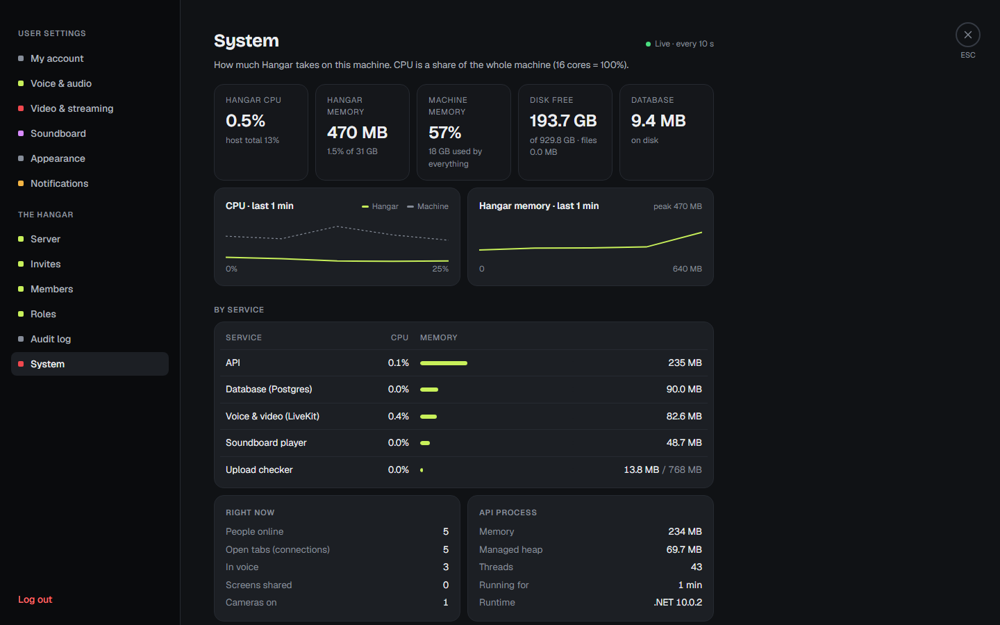
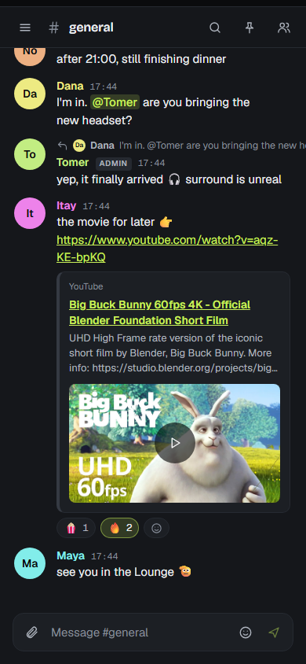
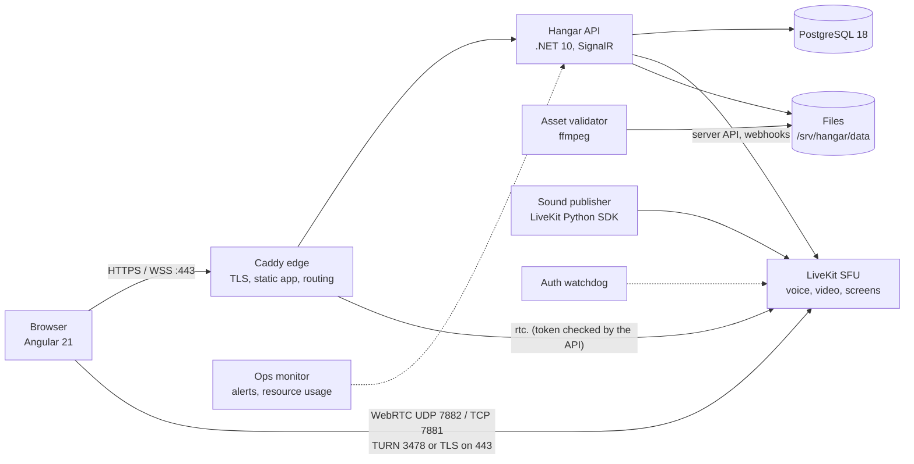

# Hangar

A private, self-hosted hangout for a small group of friends (built for ~15 people). Text, voice,
video, screen sharing, a soundboard and watch-together run on one server you own. Nothing goes to a third-party
service.



## Features

| | |
|---|---|
| **Text** | Channels, replies, reactions, mentions, pins, edit and delete, search (`Ctrl K`), attachments, link previews, unread and mention badges |
| **Direct messages** | One-to-one and group DMs (up to 10 people). Only the people in a DM can see it, the server owner included |
| **Voice** | Voice channels, per-person volume (0–200%), push-to-talk, input sensitivity, noise suppression (RNNoise), ping a friend to join |
| **Video** | Camera and screen sharing with system audio; focus or grid view; picture-in-picture |
| **Soundboard** | Upload, trim and play short sounds into the call; favourites; per-person mute |
| **Watch together** | A synced YouTube player inside a voice call |
| **Admin** | Invite links, roles and permissions, channel overrides, voice moderation, audit log, server settings, a **System** page that shows resource usage |
| **Security** | Invite-only sign-up, optional two-step login (TOTP and recovery codes), rate limits, CSRF protection, strict CSP |
| **Everywhere** | Responsive down to phone width, keyboard shortcuts, screen-reader labels |

<table>
<tr><td></td><td></td></tr>
<tr><td align="center">Voice room with a camera on</td><td align="center">Watch together in a call</td></tr>
<tr><td></td><td></td></tr>
<tr><td align="center">Group direct message</td><td align="center">Settings → System (resource usage)</td></tr>
</table>

<p align="center"></p>

## Architecture

One API process with one database, plus a media server and a few small single-purpose workers. There is no message
broker, no Redis and no microservices.



| Part | Tech | What it does |
|---|---|---|
| `apps/web` | Angular 21 (signals, OnPush), livekit-client, SignalR | The whole UI |
| `apps/api` | ASP.NET Core 10, EF Core + Npgsql, SignalR | Auth, permissions, messages, voice leases and tokens, files, realtime events (outbox) |
| PostgreSQL 18 | | All state, including the event outbox and the message search index (pg_trgm) |
| LiveKit 1.9 | SFU | Media routing, simulcast, TURN for networks that block UDP |
| Caddy 2.11 | Edge | HTTPS (Let's Encrypt), serves the app, checks LiveKit access through `forward_auth`, TURN over TLS on 443 |
| `workers/asset-validator` | Python + ffmpeg | Checks and re-encodes uploads in a sandbox (images → WebP, sounds → trimmed 48 kHz WAV) |
| `workers/sound-publisher` | Python LiveKit SDK | Plays soundboard sounds into calls |
| `workers/auth-watchdog` | Python (stdlib) | Closes media access if the API stops checking voice permissions |
| `workers/ops-monitor` | Python (stdlib) | Alerts (disk, CPU, RAM, certificates, backups, health) to a chat webhook or ntfy; per-service resource usage |

The full design (decisions, data model, security, capacity) is in [docs/architecture](docs/architecture/README.md).

## Requirements

**Server (production)**

| | Minimum | Recommended |
|---|---|---|
| CPU / RAM | 4 vCPU / 8 GB | 6 vCPU / 12 GB if there are often several screen shares at once |
| Disk | 40 GB SSD | 80–100 GB NVMe |
| Network | 200 Mbps; about 120 Mbps upload when one screen is shared to 10 people | 1 Gbps port; check the monthly traffic allowance |
| OS | Ubuntu 22.04/24.04 LTS or Debian 12, Docker Engine and the Compose plugin | |
| Domain | Three DNS records pointing at the server: `app.`, `rtc.` and `turn.` | |
| Open ports | 80, 443 and 7881 TCP; 7882 and 3478 UDP; SSH | Everything else closed, including 5349 |

The capacity notes and how to load-test a VPS are in [capacity-and-hosting.md](docs/architecture/capacity-and-hosting.md) and [load-test.md](docs/runbooks/load-test.md).

**Clients:** Chrome or Edge on Windows are the tested targets. Other Chromium browsers work; Firefox and Safari are
best-effort. For screen sharing, allow about 15–20 Mbps upload.

**Development:** Windows, macOS or Linux, with Docker Desktop, .NET SDK 10, Node 22 and Python 3.12+.

## Deploy to a VPS

1. Prepare the server: Docker, the three DNS records, and the provider firewall
   ([deploy.md §1](docs/runbooks/deploy.md)).
2. Install. The script creates every secret and config file, builds the images, migrates the database and starts the stack:

   ```sh
   sudo git clone https://github.com/Tomer258/handicaps_discord.git /opt/hangar
   cd /opt/hangar
   sudo ./infra/scripts/poc-bootstrap.sh --domain example.com --email you@example.com --ufw
   ```

3. Open the **one-time owner invite** printed by the migrate step, create your account, then clear the terminal.
4. Check the install from another machine: `./infra/scripts/poc-verify.sh --domain example.com --host <vps-ip>`.
5. Before inviting friends, set up [backups](docs/runbooks/backup-restore.md). Optionally, add an alert webhook URL to
   `/srv/hangar/config/monitor.env` for alerts.

Day-to-day commands:

```sh
alias dc='docker compose -f /opt/hangar/infra/compose.prod.yml --env-file /srv/hangar/config/hangar.env'
dc ps                    # status
dc logs -f api           # logs
# update
git pull && dc --profile ops run --rm backup && dc build && dc --profile release run --rm migrate && dc up -d
```

No VPS yet? `./infra/scripts/poc-local.sh up` runs the same production stack on your PC (https://app.hangar.localhost).

## Local development

```sh
docker compose -f infra/compose.dev.yml up -d          # Postgres (127.0.0.1:55432), LiveKit, workers
cd apps/api && dotnet run --project src/Hangar.Api     # http://localhost:5080; migrates, seeds, logs an owner invite
cd apps/web && npm ci && npx ng serve                  # http://localhost:4200 (proxies /api and /hubs)
```

Open the owner invite link from the API log to create the first account. Then invite friends from the sidebar.

## Tests

```sh
cd apps/api && dotnet test                              # unit and integration tests (Testcontainers Postgres)
python -I -m unittest discover -s workers/ops-monitor   # worker unit tests
cd tests/e2e && node scripts/smoke-chat.mjs ../../.tmp/shots   # browser smokes (real LiveKit, fake media)
```

There is a smoke script for every feature in `tests/e2e/scripts` (`smoke-voice`, `smoke-dm`, `smoke-watch` and others). CI runs the backend
tests, a production web build, the worker tests, the migration safety check, image and compose validation, and the license reports.

## Repository layout

```
apps/api        .NET API: Hangar.Api (host, endpoints, realtime), Hangar.Core (domain modules, EF Core), tests
apps/web        Angular app: core/ (api, auth, media, realtime) and features/ (messages, voice, settings, ...)
workers/        asset-validator, sound-publisher, auth-watchdog, ops-monitor
infra/          compose (dev/prod), Caddy, LiveKit config, backup image, scripts
docs/           architecture/ (design and ADRs), runbooks/ (deploy, backup, rollback, security), design/
tests/e2e       Playwright smoke scripts
```

## Operations

[Runbooks](docs/runbooks/README.md) cover deploying, backup and restore, rollback, key rotation, media problems,
dependencies, the security review and the pre-release gates.
