# Architecture diagrams

Eleven requested views follow. View 5 is split into three ER diagrams to keep it readable. Solid media arrows identify real audio/video; control messages are labeled separately. The schema document supplies fields and constraints omitted from these logical views. Every diagram is also supplied as a standalone `.mmd` source and rendered SVG in `diagrams/`.

## 1. System context

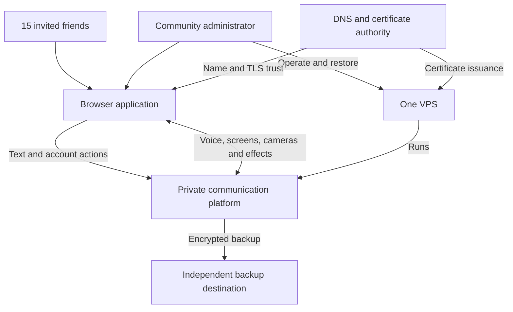

## 2. Container and component architecture

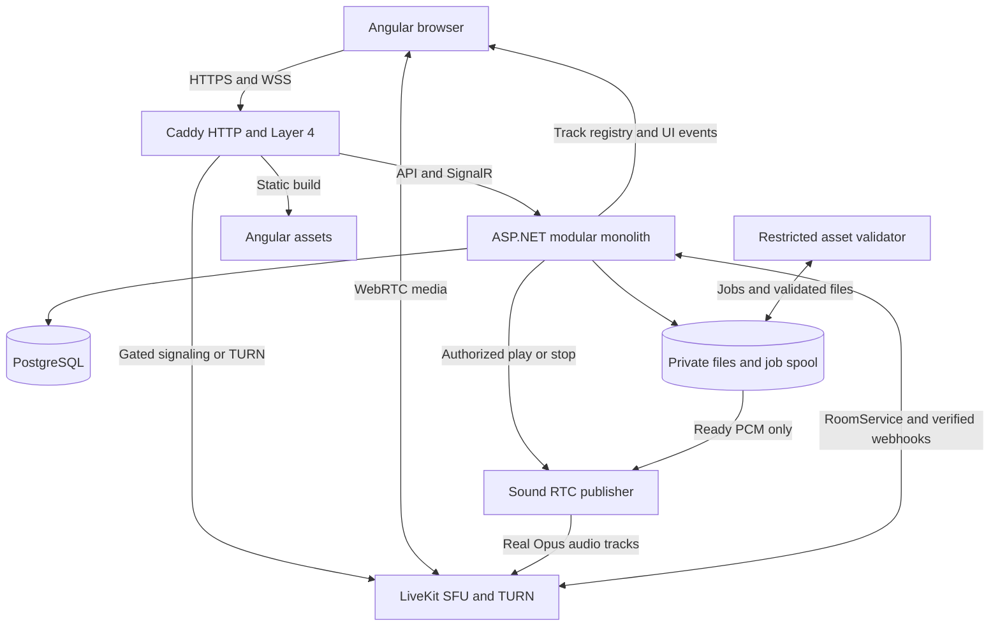

## 3. Angular frontend architecture

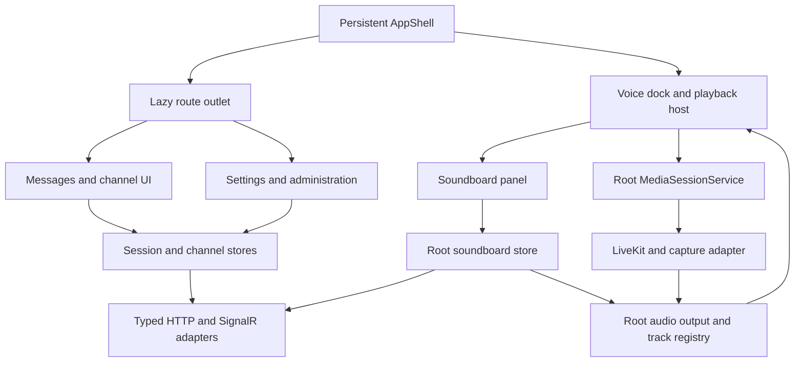

## 4. Backend module architecture

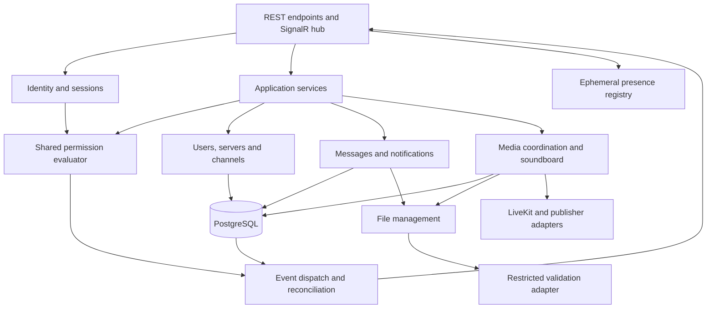

## 5a. ER model — access

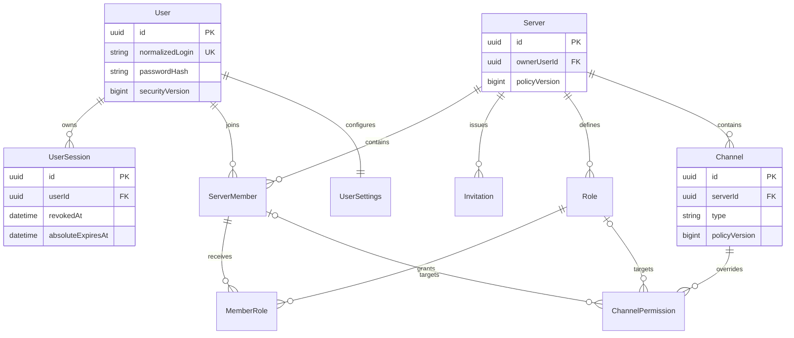

## 5b. ER model — messaging

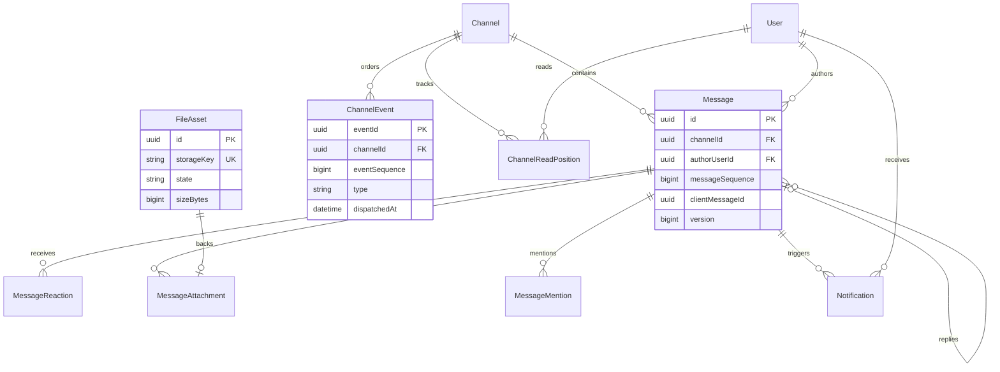

## 5c. ER model — media and soundboard

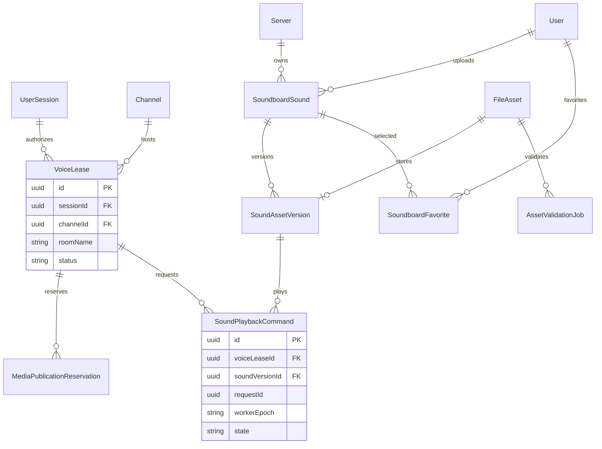

## 6. Authentication sequence

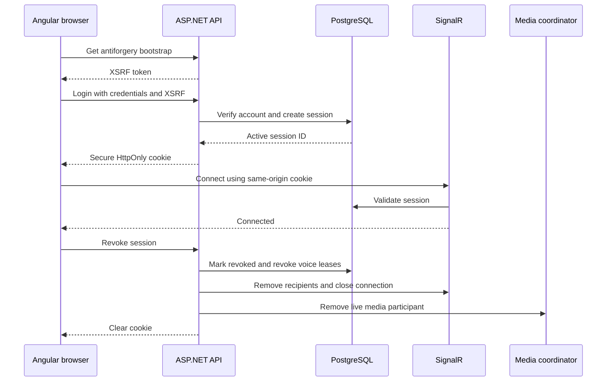

## 7. Voice-channel join sequence

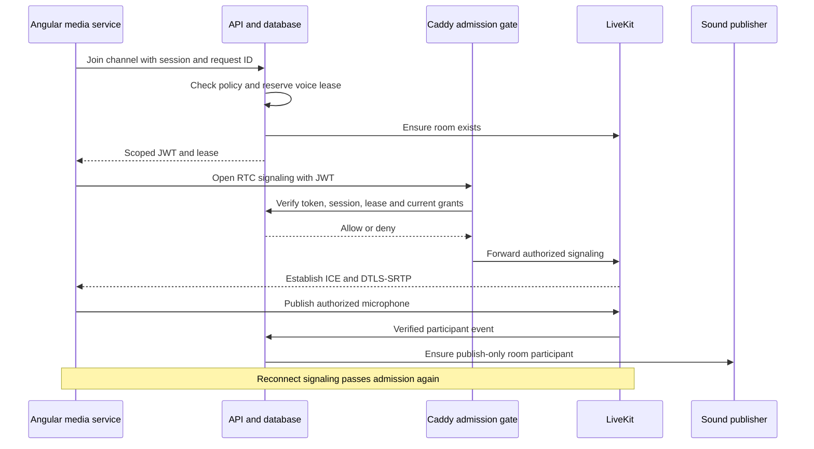

## 8. Screen sharing with system audio

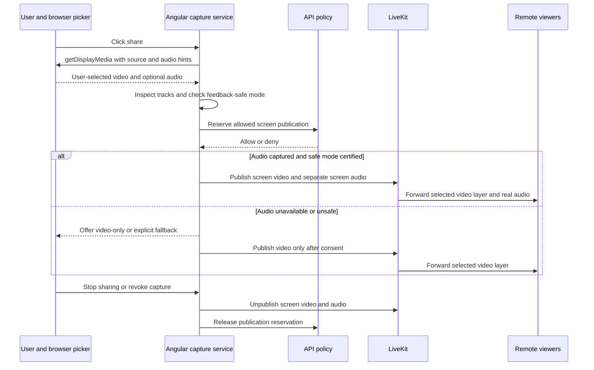

## 9. Soundboard playback sequence

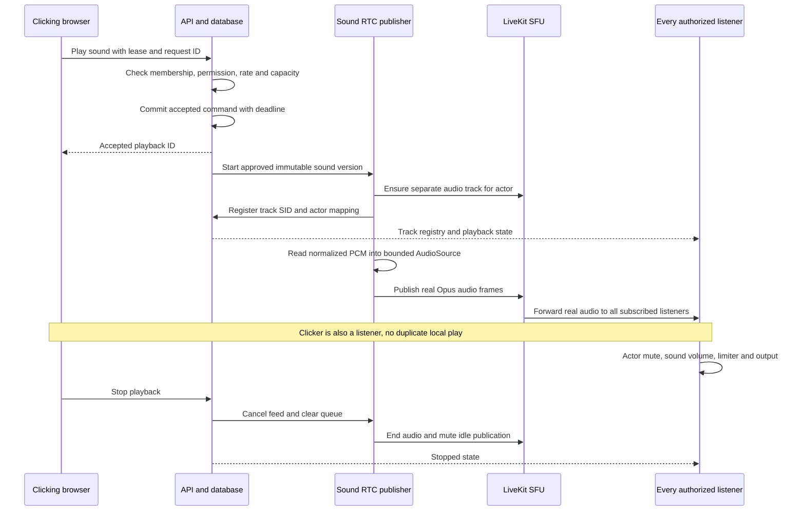

## 10. Sound upload and validation

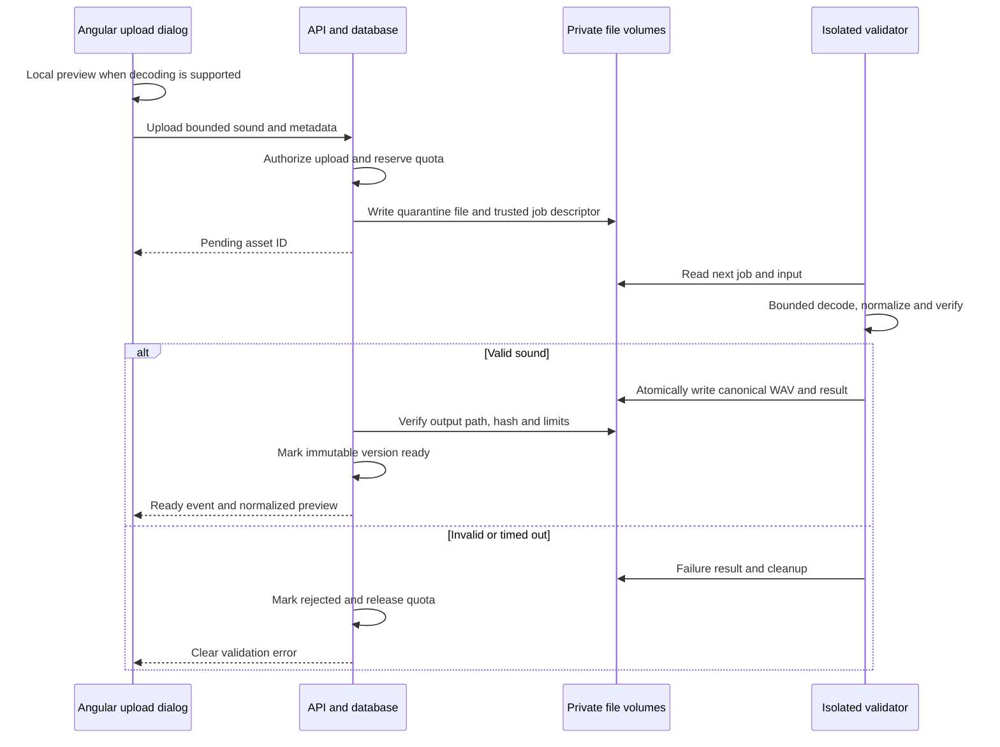

## 11. Deployment and network architecture

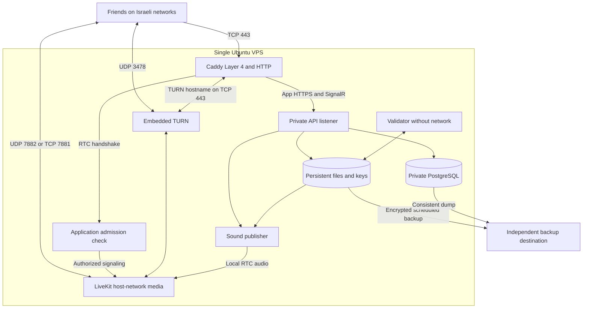
